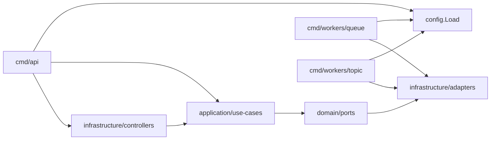
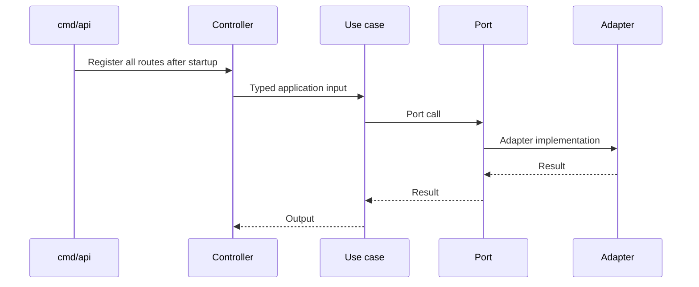
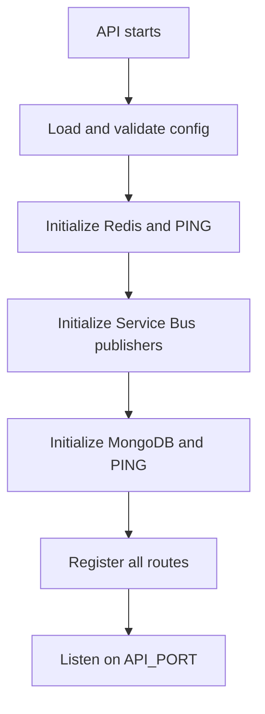
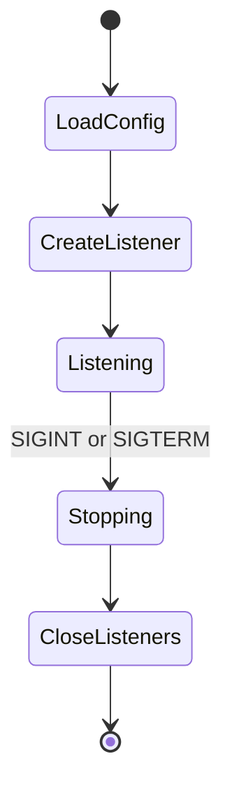

# Architecture

The template uses a layer-first hexagonal architecture. The command entrypoints
in `cmd/api` and `cmd/workers/{queue,topic,example}` load typed configuration where needed, compose the executable,
and own process lifecycle. Application packages depend only on domain ports;
concrete adapters are created and injected only in executable `cmd/...`
composition roots. Domain ports do not depend on infrastructure.

## Boundaries

- `internal/config` owns environment resolution, defaults, parsing, and
  validation.
- `internal/application/use-cases` owns plain Go inputs, outputs, and
  application behavior. Each use-case type is named `{Action}UseCase` and
  exposes exactly one exported action, `Execute`; dependency fields are
  unexported. When the folder provides context, filenames omit the type suffix:
  `get_cache.go` owns `GetCacheUseCase`, and `find_database.go` owns
  `FindDatabaseUseCase`. Keep one primary action type per focused file.
- `internal/domain/ports` defines Redis string/hash operations, one generic
  database repository contract, and Service Bus publisher/listener contracts. Port
  types use the `{Responsibility}Port` naming pattern.
- `internal/infrastructure/adapters` implements those ports for Redis, MongoDB,
  and Azure Service Bus. Adapter implementations use `{Provider}Adapter` names and
  reside under `internal/infrastructure/adapters/<provider>/...`.
- Dedicated adapters are organized under
  `internal/infrastructure/adapters/{redis,mongodb,servicebus}`.
- The example value flow uses a typed domain model and one generic database
  repository. The port exposes `DeleteOne`, `DeleteMany`, `FindOne`, `Find`,
  `Insert`, and `Upsert`; callers supply collection names, filters, and
  document/result types. The MongoDB adapter uses the native driver codec
  directly with normal structs. `ports.IDFilter` is the special filter for
  mapping a string ID to MongoDB `_id`; invalid IDs return `ErrInvalidID`.
  `Upsert` performs a full replacement with `ReplaceOne` and upsert enabled,
  returning matched/modified counts and a generated hexadecimal ID when a
  document is inserted. Connection setup and lifecycle remain separate from
  repository implementation.
- `internal/infrastructure/controllers` owns HTTP routing, DTOs, strict JSON
   handling, and transport error mapping. Controllers use contextual names such as
   `ExampleController` and `HealthController`; `controller.go` owns state,
   construction, use-case wiring, direct method/path endpoint registration, and
   controller-level error mapping. Endpoint registrations use Go method/path
   patterns directly; cache handlers read the `{key}` segment with
   `r.PathValue("key")`. Each endpoint has a focused handler file named for its
   action, such as `get_cache.go` and `find_database.go`. Keep one primary endpoint type per focused
    file. `httptransport` owns shared HTTP transport plumbing, including strict JSON decoding, JSON response writing, and endpoint error mapping; it is not application logic.
- `POST /validation/probe` demonstrates the DTO-validation boundary without
  ports or external dependencies: the controller strictly decodes and validates
  its tagged request DTO, maps it to tag-free application types, invokes the
  use case, maps to a deliberately different tagged response DTO, validates
  that response contract, and returns JSON. Request validation is a client
  error; an invalid generated response is an internal contract failure.

## API composition and mandatory integrations

The API composition in `cmd/api` initializes Redis, Service Bus, and MongoDB in order.
These are mandatory dependencies: failure exits before the server starts and
cleans up already-created resources in reverse creation order.
Only after all three succeed does it register `/health`, `/ready`, cache,
database, and Service Bus routes. Shutdown closes MongoDB, Service Bus, then
Redis. MongoDB keeps `MONGODB_URL` host-only and supports optional paired
`MONGODB_USER` and `MONGODB_PASSWORD` credentials. MongoDB query arguments are
supplied through `MONGODB_ARGS` (for example, `authSource=admin`) and are
canonicalized before URI construction. `MONGODB_SERVER_SELECTION_TIMEOUT_SECONDS`
and `MONGODB_PING_TIMEOUT_SECONDS` control startup timeouts and default to 3
seconds.

The `/ready` endpoint reports successful required-dependency
startup/bootstrap completion. It is a startup-state check, not a continuous
dependency-health probe.

## Worker lifecycle and shutdown

The queue and topic compositions create their listeners and use an
interrupt/SIGTERM context for cancellation. Listener resources are
closed on exit. The example worker runs its use case once and exits. The API closes MongoDB, its Service Bus publishers, then Redis, and gives
in-flight HTTP requests up to 10 seconds to drain before forced shutdown.

