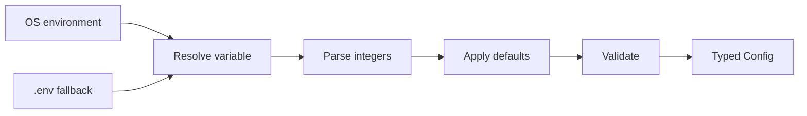

# Configuration

## Resolution and validation

Configuration is loaded by `internal/config` into nested `API`, `Redis`, and
`ServiceBus` sections. If `.env` exists, each
non-empty `.env` value is used only when the corresponding OS environment
variable is empty. OS environment variables therefore take precedence. Missing
`.env` is allowed. Values are parsed, defaults are applied, and validation
occurs before a command starts.

`API_PORT` must be an integer from `1` through `65535`. `REDIS_DB` must be an
integer greater than or equal to `0`. Invalid integers or validation failures
stop startup.

## Supported variables

| Variable | Default | Constraint | Consumer |
| --- | --- | --- | --- |
| `API_PORT` | `3000` | `1..65535` | API HTTP listener |
| `REDIS_ADDRESS` | — | Required `host:port` | API Redis adapter |
| `REDIS_PASSWORD` | empty | Redis authentication value | API Redis adapter |
| `REDIS_DB` | `0` | Integer `>= 0` | API Redis adapter |
| `AZURE_SERVICEBUS_CONNECTION_STRING` | — | Required valid SDK connection string | API publishers and queue/topic workers |
| `AZURE_SERVICEBUS_QUEUE` | `go-template-messages` | Required queue name | API queue publisher and queue worker |
| `AZURE_SERVICEBUS_TOPIC` | `go-template-events` | Required topic name | API topic publisher and topic worker |
| `AZURE_SERVICEBUS_SUBSCRIPTION` | `go-template-worker` | Required subscription name | Topic worker |

Redis and Service Bus are mandatory API dependencies. The API initializes Redis
first and Service Bus second; any failure stops startup and cleans up resources
already created. After both succeed, all API routes are registered and
`/ready` reports successful startup.

Redis performs an initial `PING`; Service Bus constructs the configured queue
and topic publishers. Later runtime failures are not converted into continuous
readiness probes. The configured queue, topic, and subscription names are also
used by the workers.

## Addresses and secrets

Direct-host development uses `localhost` values, as shown in `.env.example`.

Local emulator connection values and `SAS_KEY_VALUE` are development fixtures
only. Production must use a managed Service Bus and secret-managed connection
strings; do not copy local fixture values into deployed configuration.

## Adding a variable

1. Add a typed field with `env`, `default`, `min`, or `max` tags in
   `internal/config/config.go`.
2. Parse and validate it through the existing `Load` path.
3. Add a safe example to `.env.example` and a row to this table.
4. Wire the value into the executable composition in `cmd/api` or
   the relevant worker command, then into the adapter or controller.
5. Update the relevant local or deployment environment configuration and tests.
