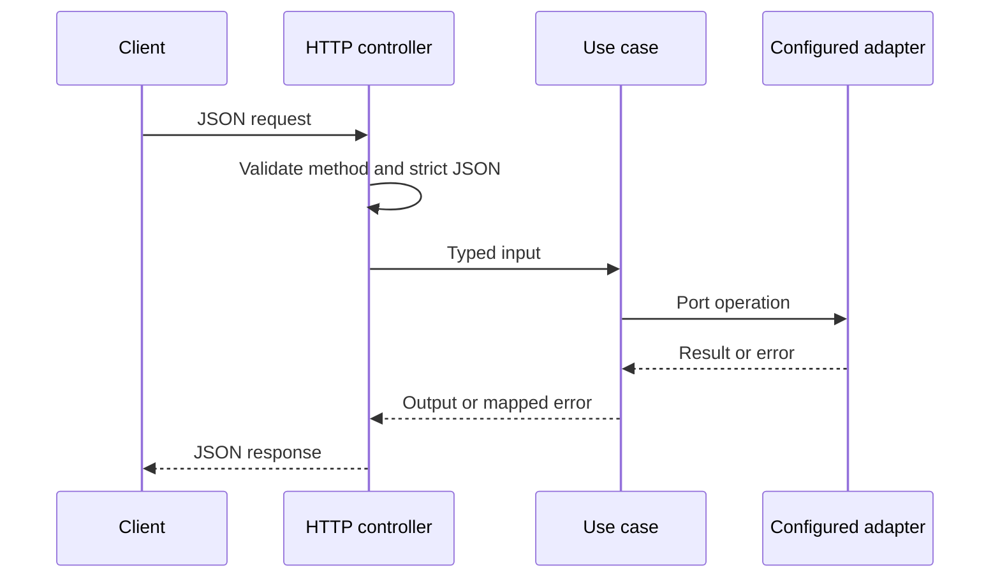

# HTTP API

The API listens on `API_PORT` (default `3000`). All JSON responses set
`Content-Type: application/json`.

## Health

| Method and route | Availability | Success | Not ready |
| --- | --- | --- | --- |
| `GET /health` | Always | `200 {"status":"ok"}` | — |
| `GET /ready` | Always | `200 {"status":"ready"}` | `503 {"status":"not_ready"}` |

Health endpoints register only explicit `GET` patterns. Native `net/http` matching
also serves `HEAD` through a `GET` pattern; other methods return native `405`
responses with the native `Allow` header.
Readiness reflects successful mandatory dependency initialization, not a
continuous health check.

## Cache

These routes are always present after successful API startup:

| Method and route | Success | Request | Response |
| --- | --- | --- | --- |
| `GET /cache/{key}` | `200` | — | `{"key":"k","value":"v"}` |
| `PUT /cache/{key}` | `201` | `{"value":"v"}` | `{"key":"k","value":"v"}` |
| `GET /cache/hash/{key}` | `200` | — | `{"key":"k","value":"v"}` |
| `PUT /cache/hash/{key}` | `201` | `{"value":"v"}` | `{"key":"k","value":"v"}` |

The hash form stores and reads the `value` field in a Redis hash. Missing values
return `404`. Cache writes replace the selected value. Unsupported methods use
native `405` handling; malformed paths are native `404` responses, while
validation failures return `400`.

Cache keys are trimmed with surrounding whitespace removed before Redis
operations. Whitespace-only keys are rejected with `400`. Successful responses
return the normalized key in `key`, including hash responses; hash operations
always use the fixed Redis field `value`.

## Service Bus

These routes are always present after successful API startup:

```http
POST /service-bus/queue/messages
Content-Type: application/json

{"message":"hello"}
```

The response is `202 {"accepted":true}`. The queue route publishes to
`AZURE_SERVICEBUS_QUEUE`; the topic route publishes to
`AZURE_SERVICEBUS_TOPIC`. Clients cannot select destinations. The worker reads
the configured queue and the configured topic subscription.

The queue and topic routes are separate focused endpoints. Each endpoint binds
directly to its stored use-case `Execute` function and validates the request
before publishing.

Controllers wire use cases first, then register every endpoint with an explicit
Go method/path pattern. Cache handlers obtain the `{key}` value with
`r.PathValue("key")`; the same value is used as the cache key. Native
`net/http.ServeMux` handles unmatched routes and method mismatches. No explicit
`HEAD` routes are registered. The path value is passed to the cache use case,
which returns the normalized key used by Redis.

## Database examples

| Method and route | Success | Request | Response |
| --- | --- | --- | --- |
| `POST /database/examples` | `201` | `{"value":"v"}` | `{"id":"...","value":"v"}` |
| `GET /database/examples/{id}` | `200` | — | `{"id":"...","value":"v"}` |

The ID is a MongoDB ObjectID encoded as lowercase hexadecimal. Invalid IDs
return `400` with `validation_error`; valid but missing IDs return `404` with
`not_found`.

## JSON and errors

Requests with bodies must use `Content-Type: application/json`, contain exactly
one JSON value, and contain only known fields. Bodies are limited to 1 MiB.
Missing, malformed, unknown-field, extra-value, or invalid payloads return:

```json
{"error":{"code":"invalid_request","message":"invalid request body"}}
```

Validation failures use `validation_error`; missing values use `not_found`;
unexpected failures use `internal_error`. Native unmatched routes and method
mismatches use the standard `net/http` responses. The application error
 statuses are `400`, `404`, and `500`.

## Validation probe

`POST /validation/probe` is a body-only demonstration endpoint. It requires
`Content-Type: application/json`. The request DTO has these fields:

| JSON field | Go value | Validation tags | Meaning |
| --- | --- | --- | --- |
| `name` | string | `required:"true" string:"true"` | Required non-empty string. |
| `enabled` | bool | `boolean:"true"` | Selects the accepted/review outcome. |
| `attempts` | int | `number:"true"` | Numeric value. |
| `mode` | string | `enum:"basic\|strict"` | Value from the enum. |
| `profile` | struct | `struct:"true"` | Nested struct. |
| `labels` | array | `array:"true"` | Slice of label structs. |
| `disabledRequired` | demonstration value | `required:"false"` | Required check is disabled. |
| `disabledString` | demonstration value | `string:"false"` | String check is disabled. |
| `disabledBoolean` | demonstration value | `boolean:"false"` | Boolean check is disabled. |
| `disabledNumber` | demonstration value | `number:"false"` | Number check is disabled. |
| `disabledStruct` | demonstration value | `struct:"false"` | Struct check is disabled. |
| `disabledArray` | demonstration value | `array:"false"` | Array check is disabled. |

The endpoint also contains disabled demonstration fields tagged with
`required`, `string`, `boolean`, `number`, `struct`, or `array` set to
`"false"`. Disabled tags do not validate their field, so those fields may have
the wrong JSON/Go shape. A tag value of `"true"` enables validation; `"false"`
explicitly disables it; an omitted tag is inactive; any other present value,
including an empty value, is an invalid tag configuration.

For the active fields, `enabled: true` produces the accepted result and
`enabled: false` produces the review result. Active fields must have the
corresponding Go type and satisfy their tags:

```json
{
  "name": "case",
  "enabled": true,
  "attempts": 3,
  "mode": "strict",
  "profile": {"name": "Ada"},
  "labels": [{"code": "A"}, {"code": "B"}]
}
```

The response is `200` and deliberately uses a different contract from the
request:

```json
{
  "result": "accepted",
  "summary": "case/strict",
  "remainingAttempts": 2,
  "processed": true,
  "subject": {"displayName": "Ada"},
  "labelCodes": ["A", "B"]
}
```

The response fields are:

| JSON field | Go value | Contract |
| --- | --- | --- |
| `result` | string | `accepted` when enabled, otherwise `review`. |
| `summary` | string | `{name}/{mode}`. |
| `remainingAttempts` | int | `attempts - 1`. |
| `processed` | bool | Processing status. |
| `subject` | object | Contains `displayName`, mapped from `profile.name`. |
| `labelCodes` | array of strings | Label `code` values in input order; an empty collection is `[]`. |

Enum tags use pipe-separated grammar such as `enum:"basic|strict"`.
Each member is trimmed at both ends before comparison. Blank members,
leading/trailing pipes, consecutive pipes, and whitespace-only members are
invalid enum configuration. Enum validation applies to string fields.
`struct:"true"` requires a direct struct value; `array:"true"` accepts slices
and arrays. Nested validation paths use `.` between fields and `[index]` for
slice or array elements, for example `profile.name` and `labels[0].code`.

Processing has three distinct failure stages:

1. Strict decoding rejects a missing, malformed, trailing, or unknown-field
   JSON body, and wrong JSON shapes that cannot be decoded into the request
   DTO. These are `invalid_request` errors and return `400`.
2. Request DTO validation rejects decoded values that violate active tags.
   These are `validation_error` errors and return `400`. Disabled
   demonstration fields are accepted even when their decoded values would fail
   the corresponding validation if enabled.
3. The use case output is mapped to the response DTO and validated. A
   response contract failure is an ordinary internal error, classified as
   `internal_error` and returned as `500`.

The controller owns the tagged request and response DTOs. After request
validation it maps the DTO to plain, tag-free application input; after use-case
execution it maps plain application output to the response DTO before response
validation. Application types do not carry JSON or validation tags.


