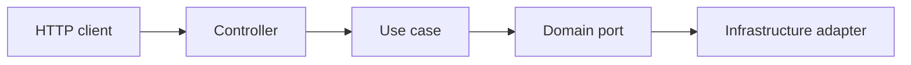

# Learn Go through this template

This guide is for a TypeScript developer who wants to become productive in
this project. It uses the repository's API, worker, configuration, ports, and
adapters as concrete examples rather than treating Go as a collection of
syntax differences.

For the complete project contracts, see the [documentation
index](README.md).

## 1. The Go mental model

Go is a compiled, statically typed language with a small language surface and a
strong standard library. The most important shift from TypeScript is that Go
does not organize application behavior around classes, decorators, or a
runtime type system:

- A **package** is the unit of compilation and organization.
- A **struct** groups data; behavior is attached with methods.
- Functions return values directly, often as `(value, error)`.
- Interfaces describe behavior and are satisfied implicitly.
- Goroutines and channels make concurrency available, but ordinary
  synchronous code is the default.
- `go fmt`, `go test`, and the compiler provide much of the feedback that a
  TypeScript project may obtain from linting, tests, and build tooling.

The repository has four process entrypoints and composition roots: `cmd/api`,
`cmd/workers/queue`, `cmd/workers/topic`, and `cmd/workers/example`. Application packages are
kept independent from infrastructure packages, and configuration is loaded
before either runtime starts.

### TypeScript-to-Go vocabulary

| TypeScript idea | Go equivalent in this project |
| --- | --- |
| `package.json` module boundary | `go.mod` module and Go packages |
| `interface` | Go interface, usually defined by its consumer |
| class with constructor | struct plus a constructor function named `New{ExactTypeName}` |
| thrown exception | returned `error` value |
| `async` function | ordinary function unless it explicitly starts concurrent work |
| dependency injection framework | explicit construction and wiring in `cmd/api` or a worker command |
| environment schema | typed configuration loaded by `internal/config` |
| controller/service/repository | controller, use case, port, and adapter boundaries |

## 2. Packages and export visibility

Every `.go` file declares a package. Files in the same directory normally
belong to the same package and can use one another's unexported identifiers.
An import path refers to a package directory, not an individual file.

Go uses capitalization for visibility:

- `NewCacheHandler` and `Load` are exported and can be used by another package.
- `cacheHandler` and `loadValue` are unexported and are available only inside
  their package.

This is different from TypeScript's `public` and `private` keywords. Visibility
is part of the identifier spelling, so choose names deliberately. Keep
implementation details unexported unless another package needs them. A small
public API is easier to understand and test.

The `internal` directory adds a module-level boundary: packages below it are
intended for use by this module, not external consumers. In this project,
`internal/config`, `internal/application`, `internal/domain`, and
`internal/infrastructure` form the service's internal implementation. When a
folder already provides context, Go filenames should name the action without
repeating the type suffix: `get_cache.go` owns `GetCacheUseCase` in
`application/use-cases/example`, and the matching controller endpoint in
`infrastructure/controllers/example`. Keep one primary action or endpoint type
per focused file.

Useful commands while learning:

```sh
go list ./...
go doc ./internal/domain/ports
go test ./...
```

## 3. Structs, methods, and pointers

A struct is a named collection of fields:

```go
type Message struct {
    Text string
}
```

Methods declare their receiver explicitly:

```go
func (m Message) Empty() bool {
    return m.Text == ""
}
```

Use a value receiver when the method does not need to mutate the value and a
copy is acceptable. Use a pointer receiver when the method mutates state, when
the value is large, or when the type has meaningful identity:

```go
type Readiness struct {
    ready bool
}

func (r *Readiness) MarkReady() {
    r.ready = true
}
```

Pointers may be `nil`, so dereference only when the contract guarantees a
value. Go does not have TypeScript-style optional chaining for arbitrary
pointer access; make absence explicit and handle it near the boundary.

Constructors are ordinary functions named exactly `New{ExactTypeName}`:

```go
func NewReadiness() *Readiness {
    return &Readiness{}
}
```

There is no constructor overloading. Prefer a clear constructor, a small
options struct, or separate functions rather than a large set of optional
arguments.

## 4. Interfaces and ports

Go interfaces are satisfied implicitly. A type does not declare that it
implements an interface; it implements every method with the required names
and signatures.

That property supports this project's ports-and-adapters design. A port can
describe only the behavior a use case needs. Name ports
`{Responsibility}Port`:

```go
type RedisPort interface {
    Get(ctx context.Context, key string) (string, error)
    Set(ctx context.Context, key, value string) error
}
```

The Redis adapter can satisfy `RedisPort`, while a test fake can satisfy it
without importing Redis. Prefer defining an interface at the consuming
boundary instead of mirroring a whole third-party client. Name concrete
adapters `{Provider}Adapter`, and keep them under
`internal/infrastructure/adapters/<provider>/...`.

The repository's `internal/domain/ports` package contains contracts for Redis
operations and Service Bus publishing/listening. Adapters under
`internal/infrastructure/adapters` implement those contracts. The domain
does not depend on infrastructure.

Compile-time assertions can document an intended relationship:

```go
var _ ports.RedisPort = (*RedisAdapter)(nil)
```

Use interfaces for a meaningful boundary, not for every small concrete value.
Concrete types are often simpler within one package.

## 5. Explicit errors

Errors are values. A function reports failure by returning an `error`, and the
caller decides whether to return it, wrap it, translate it, retry it, or
continue:

```go
value, err := store.Get(ctx, key)
if err != nil {
    return "", fmt.Errorf("get cache value: %w", err)
}
return value, nil
```

The `%w` verb preserves the underlying error for `errors.Is` and
`errors.As`. Use sentinel or typed errors when callers need stable
classification. Do not log and discard an error unless the failure is
intentionally non-fatal.

At the HTTP boundary, controllers map application outcomes to stable JSON
error codes and HTTP statuses. Keep transport concerns there: use cases should
return application-level results and errors rather than writing HTTP responses.

## 6. Context and cancellation

`context.Context` carries cancellation, deadlines, and request-scoped values.
Pass it as the first parameter of functions that perform I/O or may take
substantial time:

```go
func (u *GetCacheUseCase) Execute(ctx context.Context, key string) (string, error) {
    return u.store.Get(ctx, key)
}
```

Use-case types are named `{Action}UseCase`, expose exactly one exported action
(`Execute`), and keep helpers and dependency fields unexported.

Do not store a context in a long-lived struct, and do not use it as a
general-purpose parameter bag. Derive a context when you own a deadline or
need cancellation, and always call the associated cancel function.

The API passes request context through controllers, use cases, ports, and
adapters. The worker uses an interrupt/SIGTERM context to stop listener loops,
then closes listener resources. A loop should check cancellation and return
promptly rather than waiting forever on work.

## 7. Configuration as a typed boundary

Configuration belongs at the edge of the application. This project loads
environment values through `internal/config`, applies defaults, parses typed
values, validates them, and returns a typed configuration object before
starting a command.

The precedence is:

1. An operating-system environment variable, when non-empty.
2. A non-empty value from `.env`, when present.
3. The field's default, where defined.
4. Validation before startup.

Keep environment names and parsing in configuration. Pass typed values inward;
do not make use cases read environment variables directly. Optional
integrations expose typed `Enabled()` methods. Empty connection values disable
 them; enabled integrations are initialized only by the executable composition root.
Initialization failures stop startup instead of appearing later as ambiguous
runtime failures.

When adding a variable, update the typed configuration, validation/default
behavior, safe example, documentation, composition root, and relevant tests.
See [Configuration](configuration.md).

## 8. Request flow: API, controller, use case, adapter

The executable `cmd/...` composition root wires dependencies explicitly. It
creates and injects concrete adapters; application packages receive only domain
ports:



The responsibilities are intentionally narrow:

1. `cmd/api` loads configuration and constructs enabled adapters, creates use
   cases, and registers controllers in the same executable directory.
2. A controller validates the method, path, content type, strict JSON body,
   and transport-level constraints.
3. The controller converts the request into a typed application input.
4. The use case applies application behavior and calls a domain port.
5. The adapter performs Redis or Service Bus I/O and returns a result or error.
6. The controller maps the use-case result to JSON and an HTTP status.

For example, a cache request enters a controller, becomes a key/value input,
calls a use case, reaches the Redis port, and returns through the same layers.
Health and readiness are registered by the API regardless of optional feature
integrations.

## 9. Worker and message flow

The queue and topic worker commands use the same configuration and compose one
listener each, while the example worker has no external configuration. Their
delivery boundary is a listener rather than HTTP:

1. Load and validate configuration.
2. Exit cleanly when Service Bus is not configured.
3. Construct the command listener through an infrastructure adapter.
4. Start receive loops with a cancellation context.
5. Decode and handle messages through the appropriate application boundary.
6. Stop on interrupt or SIGTERM, close listener resources, and return.

The API publishes to the configured queue or topic through a port. The queue
worker reads the configured queue, and the topic worker reads the configured
topic subscription. Keep message transport
details in adapters and listener controllers; keep application behavior
testable with plain values and interfaces.

## 10. Testing in Go

Tests live beside the implementation in `_test.go` files. A test function has
the shape `func TestThing(t *testing.T)`. Table-driven tests make related
inputs and expected outcomes explicit:

```go
func TestValidateKey(t *testing.T) {
    tests := []struct {
        name string
        key  string
        want error
    }{
        {name: "empty", key: "", want: ErrInvalidKey},
        {name: "valid", key: "item-1", want: nil},
    }

    for _, tc := range tests {
        t.Run(tc.name, func(t *testing.T) {
            if got := ValidateKey(tc.key); !errors.Is(got, tc.want) {
                t.Fatalf("ValidateKey() error = %v, want %v", got, tc.want)
            }
        })
    }
}
```

Start with unit tests for validation and use-case behavior. Use fakes for
ports, component tests for package boundaries, and opt-in integration tests
for real dependency behavior. Test error paths, cancellation, readiness, and
the mapping from application outcomes to HTTP responses.

The standard commands are:

```sh
go test ./...
go test -tags=integration ./...
```

See [Testing](testing.md) for this project's test layers and prerequisites.

## 11. Guided feature-addition workflow

Use this sequence when adding a feature:

1. **Define the behavior.** Write the user-visible outcome, invalid inputs,
   error classifications, and whether the feature is optional.
2. **Choose the boundary.** Decide whether the feature is an HTTP route, a
   worker message flow, or both.
3. **Define plain types.** Add focused input/output structs and domain errors
   in the application or domain boundary.
4. **Define the smallest port.** Describe only the operations the use case
   needs. Keep external SDK types out of the port.
5. **Implement the use case.** Inject the port, accept a context when I/O is
   involved, and return explicit results and errors.
6. **Implement the adapter.** Translate between the port and external service;
   wrap errors with operation context and honor cancellation.
7. **Wire the composition root.** Construct the adapter, use case, and
   controller or listener in the relevant `cmd/api` or worker command.
8. **Add the transport boundary.** Validate HTTP or message input and map
   application results without moving business rules into the boundary.
9. **Test each layer.** Add unit tests with fakes, boundary tests, and an
   integration test only where real dependency behavior matters.
10. **Update contracts.** Document configuration, routes, operational impact,
    and the relevant page in the [documentation index](README.md).

Make one narrow vertical slice work before adding abstractions. If a feature
does not need a new port, do not create one merely to follow a pattern.

## 12. A practical proficiency plan

### First session

- Read this guide, [Architecture](architecture.md), and
  [Configuration](configuration.md).
- Run the unit suite and inspect one controller, one use case, one port, and
  one adapter.
- Rewrite a small TypeScript function as a Go function returning `(value,
  error)`.

### First week

- Practice packages, exported names, structs, pointer receivers, and
  table-driven tests.
- Trace a cache request from HTTP input through the controller, use case, port,
  and adapter.
- Add a fake for a port and test both success and failure paths.
- Read every `context.Context` boundary and explain who cancels it.

### First feature

- Follow the guided workflow above.
- Keep the change small enough to review as one vertical slice.
- Prefer explicit construction over adding a framework.
- Document configuration and operational behavior as part of the feature.

### Ongoing practice

- Use the compiler and tests as design feedback.
- Read the standard library documentation for interfaces you consume.
- Review error wrapping and cancellation behavior during code review.
- Measure complexity by boundary count and dependency direction, not by the
  number of classes or files.

The goal is not to write TypeScript with Go syntax. It is to make ownership,
failure, cancellation, and dependencies visible in the program.
