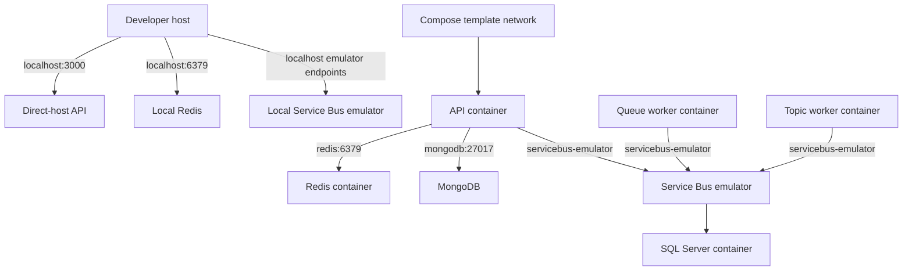

# Local development

## Mode selection

| Mode | Start command | Dependencies | Addresses |
| --- | --- | --- | --- |
| Direct host | `go run ./cmd/api` | Host-local dependencies started separately | `localhost` |
| Default Docker Compose | `docker compose up --build` | API, Redis, MongoDB, Service Bus emulator, SQL Server | API reaches Redis, `mongodb`, and `servicebus-emulator` |
| Worker profile | `docker compose --profile broker up --build` | Long-running queue/topic workers plus default infrastructure | Workers reach `servicebus-emulator` |

The default Compose stack includes the API's mandatory Redis, MongoDB, Service
Bus emulator, and SQL Server infrastructure. MongoDB data persists in the
`mongodb-data` named volume, and port 27017 is not published. The `broker` profile adds only the
long-running queue/topic workers. Compose publishes API port `3000`, emulator
ports `5672` and `5300`, and does not publish Redis port `6379`; direct-host
commands therefore require separately running host Redis and MongoDB.



## Start and stop

Direct host:

```sh
cp .env.example .env
go run ./cmd/api
```

Default Compose:

```sh
docker compose up --build
docker compose down
```

Worker profile:

```sh
docker compose --profile broker up --build
docker compose --profile broker down
```

For the detailed manual Docker/Compose verification sequence, including
readiness polling, cache operations, emulator startup, message publishing,
worker logs, and failure interpretation, see [Manual Docker Compose
verification](manual-docker-compose-testing.md). `/health` confirms the API
process responds. `/ready` reports successful startup initialization for
mandatory dependencies; it is not a continuous dependency probe.

## Address and credential boundaries

`localhost` from a host process means the host machine. Inside Compose,
`localhost` means the current container, so configured dependencies must use
Compose service names. The Service Bus emulator and its credentials are
local-only; production uses managed services and secret management.
MongoDB uses separate host, port, database, optional paired credentials, and
URL query arguments; `MONGODB_URL` is host-only. `MONGODB_ARGS` accepts query
arguments such as `authSource=admin` and is canonicalized before being added to
the URI. `MONGODB_SERVER_SELECTION_TIMEOUT_SECONDS` and
`MONGODB_PING_TIMEOUT_SECONDS` default to 3. Keep usernames, passwords, and
other secrets in local environment files or a secret manager; do not commit them.
The API treats Redis, MongoDB, and Service Bus as mandatory dependencies:
startup must complete their initialization before serving traffic, and shutdown
cleans them up in reverse dependency creation order.
