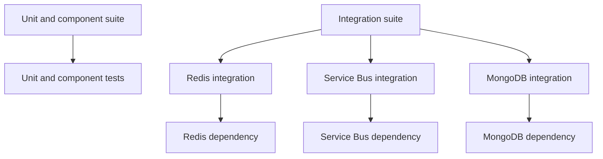

# Testing

Tests are colocated with the implementation. Unit and component tests run
without external services. Adapter integration tests are opt-in and exercise real dependency behavior.

## Test layers

- Unit tests cover validation, use cases, controllers, and adapter behavior
  with local inputs or fakes.
- Component tests exercise package boundaries without requiring deployed
  dependencies.
- Integration tests are opt-in and include side effects in the named
  dependency: Redis writes a unique test key and registers cleanup, MongoDB
  writes a unique document and registers cleanup, while
  Service Bus publishes and receives unique test messages through static
  dedicated queue and topic entities.

MongoDB integration tests use `//go:build integration` and require
`MONGODB_INTEGRATION_URL`, optional paired `MONGODB_INTEGRATION_USER` and
`MONGODB_INTEGRATION_PASSWORD`, `MONGODB_INTEGRATION_PORT`,
`MONGODB_INTEGRATION_DATABASE`, `MONGODB_INTEGRATION_ARGS`, and optional
`MONGODB_INTEGRATION_SERVER_SELECTION_TIMEOUT_SECONDS` and
`MONGODB_INTEGRATION_PING_TIMEOUT_SECONDS`. The integration timeout controls
default to 3 seconds, and arguments use query syntax such as `authSource=admin`.
Integration coverage is opt-in and requires the dependency environment
described in [Local development](local-development.md).

Automated tests validate repeatable behavior in the test suite. They are
separate from manual runtime verification: use the [Manual Docker Compose
verification](manual-docker-compose-testing.md) guide to exercise the running
API, Redis, Service Bus emulator, and workers through their real network
boundaries.

## Test environment

Use a Go 1.25 environment to run the tests. For dependency setup and supported
environment modes, see [Local development](local-development.md).

## Troubleshooting

- A Redis integration failure usually means no service is listening at the
  configured address or the configured authentication value is incorrect.
- A Service Bus integration failure requires the configured Service Bus
  dependency and entities to be available.
- A MongoDB integration failure requires a reachable MongoDB instance and the
  integration variables above.
- Do not infer a passing integration test or manual runtime check from a
  healthy API alone; dependency-backed checks must perform the relevant real
  operations. The manual guide also requires emulator readiness and worker log
  evidence.
